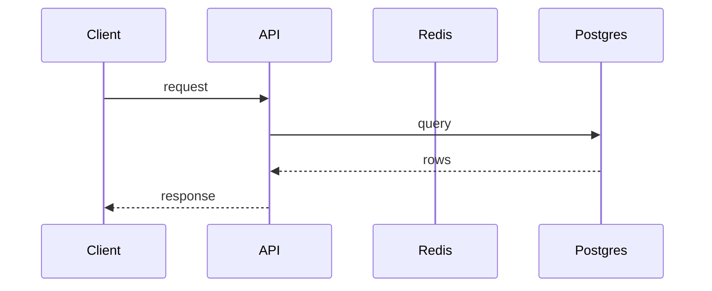

## What

<!-- One or two sentences: what this PR adds or changes. -->

## Why

<!-- The problem it solves. Link the ADR behind any design change: docs/adr/NNNN-....md -->

## How it flows

<!-- A mermaid diagram of the changed path: a sequence diagram for request flows, a flowchart for data or control flow. -->



## Changes

<!-- One line per commit, in order. -->

-

## Test coverage

<!-- Posted by CI as a comment: total, per changed file, and change from master. Do not type numbers here by hand. -->

## Contract

<!-- Posted by CI: oasdiff result against master ("no breaking changes" or the list). Paste the contract-reviewer verdict here. -->

## How to verify

```sh
# Commands a reviewer can run, each with the output to expect.
```

## Checklist

- [ ] Design decisions have an ADR, linked above
- [ ] Commits are conventional and each passes on its own
- [ ] Migrations round-tripped on the scratch DB
- [ ] `api/openapi/v1.json` and `packages/sdk` regenerated if the API changed
- [ ] No secrets, no `.env` changes
